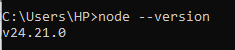
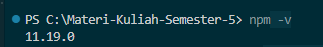
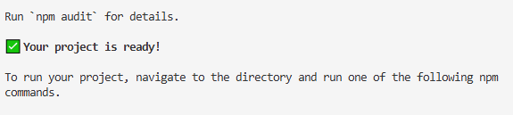
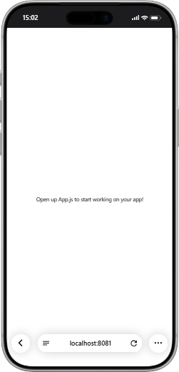
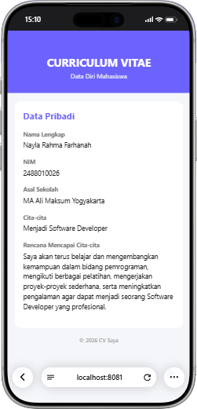

# Praktikum Menyiapkan dan Memulai Pemrograman Mobile (React Native) #

### Tujuan Pembelajaran ###
Mahasiswa mampu :
1. Menyiapkan dan memulai pemrograman mobile(react native)
2. membuat aplikasi mobile
3. membuat cv sederhana dengan react native

### materi pembelajaran ###
1. Menyiapkan dan Memulai Pemrograman Mobile (react native)
- Install Interpreter Node.JS
- download dan install node.js di alamat https://nodejs.org/en/download/
- konfirmasi versi node.js
- node -v

2. membuat aplikasi mobile (react native)
- untuk referensi dokumentasi resmi milik expo
- https://docs.expo.dev/
- untuk referensi dokumentasi resmi milik react native
- https://reactnative.dev
- memulai membuat projek baru dengan framework expo go
- npx create-expo-app prtmn2 --template blank

3. menjalankan aplikasi mobile (react native)
- cd ptmn2
- npx expo start
- install Expo go via playstore
- install Expo go via app store
- Buka dan Scan QR Code Via Expo Go
- Running via Web Browser Emulator
- ctrl+c untuk menghetikan server
- sebelumnya install (npx expo install react-dom react-native-web)
- npx expo start --web

4. Tugas Praktikum Pemrograman Mobile (React Native)
- Menambagkan CV sederhana dengan React Native
- Nama Lengkap
- NIM
- Asal Sekolah
- Cita-cita
- Rencana mencapai cita-cita

